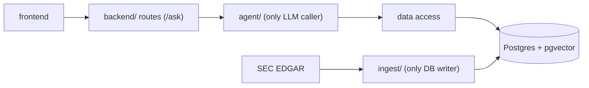

# CLAUDE.md

This file provides guidance to Claude Code (claude.ai/code) when working with code in this repository.

@AGENTS.md

## Current state

The repo holds only docs; no code, `pyproject.toml`, `package.json` or `docker-compose.yml` exists yet. Check `docs/STATUS.md` for what is built. The commands below are the ones `docs/PROCESS.md` requires the build to provide.

## Commands

| Task                                        | Command                                            |
| ------------------------------------------- | -------------------------------------------------- |
| Install everything (and the pre-commit hook) | `uv sync && npm install` at the repo root          |
| Start Postgres (pgvector) and MLflow        | `docker compose up -d`                             |
| Run backend and frontend                    | `npm run dev`                                      |
| Every check                                 | `npm run check`                                    |
| One Python test                             | `uv run pytest path/to/test_file.py::test_name`    |
| Score the agent                             | `npm run evals` (real model; only when asked or at the end of a plan) |

`npm run check` covers ruff (lint and format), pyright, pytest at 80% coverage, ESLint, Prettier, tsc, vitest at 80% coverage, and Playwright. Always `uv run`, never `python3`.

## Architecture

One-way call flow; respect it when placing code:

- `ingest/` is offline: fetch from EDGAR (`httpx`, under 10 req/s, User-Agent from `.env`), parse (BeautifulSoup/lxml), chunk, embed (Voyage AI), load. XBRL facts are the source of truth for figures.
- Retrieval is hybrid: pgvector plus Postgres full-text.
- The agent framework is undecided; it is chosen by experiments in `labs/` first. Product code never imports from `labs/`.
- EDGAR, the LLM and embeddings sit behind small swappable interfaces. Tests use a stub model and never call a real one.
- The agent must never read `evals/` answers (R-11); don't open them yourself unless asked.
- Every answer is traced (MLflow) so question, sources, steps and cost are reviewable (R-06).

## Workflow essentials

- "Plan" means write `docs/PLAN.md` only, then stop. "Implement" means build every phase in order, ticking criteria and updating `docs/STATUS.md` per phase, committing with requirement ids.
- Never `--no-verify`, never push, never lower thresholds or exclude files to go green; ask instead.
