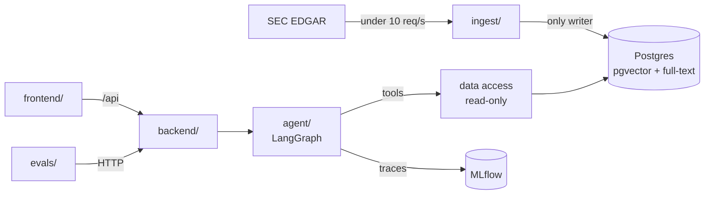

# Plan: the filings pilot

Builds the pilot in `docs/SPEC.md`: an ingest pipeline for EDGAR filings and XBRL, the OpenSec Analyst agent, one backend API and a two-pane UI. Phase 0 is a lab that confirms LangGraph on AMD and NVIDIA.

## The shape of the build

- **The model never types a number.** It cites XBRL fact ids or `compute` results; Python formats them (R-07, R-08).
- **Citations are checked.** Every quote must be an exact substring of its passage, or the answer is rejected (R-03).
- **Review comes from MLflow traces**: question, steps, sources, cost (R-06).

## Decisions for review

1. **LangGraph.** Phase 0 confirms it; then `docs/TECH_STACK.md` says LangGraph. If it fails, I stop and report.
2. **The lab writes files, not the database.** It caches filings in `data/filings/` (git-ignored); Phase 1 reuses the cache.
3. **Companies.** AMD and NVIDIA now; the other 18 wait on SPEC open question 1.
4. **Window.** The last 3 completed fiscal years' 10-Ks and 10-Qs, plus this year's 10-Qs, in each company's fiscal calendar (R-09).
5. **Lab samples.** 10 questions I draft in `data/labs/samples.yaml`, marked `reviewed: false` until an analyst checks them. Separate from `evals/`.
6. **Chunks follow Items** and store ticker, form, period, Item and offsets, for chips like `AMD 10-K 2025 · Item 7`.
7. **Search** merges pgvector and full-text results by reciprocal rank fusion.
8. **Restated** means a later filing reports a different value; both are kept and the answer flags it (R-09).
9. **Follow-ups** use a LangGraph Postgres checkpointer in its own `agent_state` schema (R-04). *Approved* as the one exception to "only `ingest/` writes the database".
10. **Answers** are structured (summary, table or bullets, caveats) and not streamed (R-02).
11. **Cost** comes from token counts and prices in `.env`.
12. **New filings** are added with `uv run -m ingest AMD`, not an API (R-12).
13. **Scoring.** Figures, "Not disclosed" and latency are checked in Python; an LLM judge in `evals/` grades accuracy and citation support. *Approved* as the one exception to "only `agent/` calls the LLM". The 50 questions wait on SPEC open question 2.
14. **Out of scope:** 8-K, Form 4, proxies, sign-in, exports, stock prices.

## API

| Method and path                | operation_id | Used by                                      |
| ------------------------------ | ------------ | -------------------------------------------- |
| `GET /api/health`              | `health`     | frontend, e2e                                |
| `POST /api/ask`                | `ask`        | frontend, evals; `{question, conversation_id}` |
| `GET /api/answers/{answer_id}` | `get_answer` | review page (R-06)                           |

`answer_id` is the MLflow trace id.

---

## Phase 0: LangGraph lab

Prove LangGraph does what the agent needs, on real filings, and set up repo tooling.

- Repo skeleton: `pyproject.toml`, `package.json` scripts, ruff, pyright, pre-commit hook, `.env.example`, Docker Compose (Postgres, MLflow). The lab code lives in the notebook, so pytest joins `npm run check` in Phase 1.
- `data/tickers.yaml`, `labs/BRIEF.md`, `data/labs/samples.yaml`.
- A notebook that caches AMD and NVIDIA filings, indexes them in memory, and runs a LangGraph agent with `search_passages`, `get_fact` and `compute`, logging to MLflow.

Success criteria:

- [x] `uv sync && npm install` and `docker compose up -d` work; `npm run check` passes.
- [x] The notebook runs end to end with no second over 9 EDGAR requests (R-12).
- [x] All 10 samples answer as summary, table or bullets, caveats (R-02).
- [x] Every figure matches XBRL, with unit and fiscal period (R-05, R-08, R-09).
- [x] Every claim is cited, and every quote is in its passage (R-03).
- [x] The no-answer sample says "Not disclosed in the filings." (R-07).
- [x] "And the year before?" works on the same thread (R-04).
- [x] Stock-price and buy questions are refused with no tool calls (R-10).
- [x] Every run is an MLflow trace with tokens; median latency under 15 s (R-06, R-13).
- [x] The decision is in `docs/STATUS.md` and `docs/TECH_STACK.md`.

## Phase 1: Ingest

Load filings and XBRL into Postgres, repeatably.

- `ingest/` owns the models and Alembic migrations: companies, filings, chunks (Item, offsets, embedding, `tsvector`), XBRL facts (with restated flag).
- Four modules: `edgar_client`, `filing_parser`, `xbrl_facts`, `loader`.
- pytest at 80% coverage joins `npm run check` and the pre-commit hook.
- `uv run -m ingest` loads `data/tickers.yaml`; `uv run -m ingest AMD` loads one ticker; reruns skip loaded filings.

Success criteria:

- [ ] `uv run pytest ingest` passes, with EDGAR and the embeddings API mocked.
- [ ] Tests confirm no more than 9 requests a second and the `.env` User-Agent (R-12).
- [ ] A test confirms a restated fact is flagged and both values are kept (R-09).
- [ ] Loading AMD and NVIDIA matches the EDGAR submissions list; a rerun adds nothing.
- [ ] AMD's FY2025 revenue in the database matches companyfacts (R-08).
- [ ] `npm run check:python` passes at 80% coverage.

## Phase 2: The agent

Answer one question end to end through tools.

- Read-only data access over the `ingest/` models; tools `search_passages`, `get_fact`, `list_filings`, `compute`.
- Structured answers, the Python renderer and the citation check; `agent/instructions.md`.
- The LangGraph graph on `MODEL_NAME` (default `gpt-6.1-terra`, medium reasoning), with checkpointer and MLflow tracing; `uv run -m agent "question"`.

Success criteria:

- [ ] Stub-model tests: figures render from XBRL, and a bad citation rejects the answer (R-03, R-05, R-08).
- [ ] Tests: `compute` matches Python math; no figure appears without a fact or compute id (R-07).
- [ ] Tests: follow-ups see the earlier turn (R-04); restatements add a caveat (R-09).
- [ ] A test confirms nothing in `agent/` or `backend/` reads `evals/` (R-11).
- [ ] By hand with a real model, the lab samples do at least as well as in Phase 0.
- [ ] `npm run check:python` passes.

## Phase 3: The backend

- FastAPI with `health`, `ask` and `get_answer`; thin routes over the agent and MLflow.

Success criteria:

- [ ] `uv run pytest backend` passes, with the agent stubbed.
- [ ] `ask` returns the answer and cited passages with highlight offsets (R-02, R-03).
- [ ] A second `ask` on the same `conversation_id` answers the follow-up (R-04).
- [ ] `get_answer` returns question, sources, steps, tokens and cost (R-06).
- [ ] `/openapi.json` shows an `operation_id` and summary on every operation, with no optional inputs.

## Phase 4: The UI

- shadcn preset `b1uGaJrhQ`, brand fonts, light and dark mode.
- Chat on the left, the cited passage highlighted on the right; citation chips; number formatting per `docs/BRAND.md`.
- A review page at `#/answers/{answer_id}` (R-06).

Success criteria:

- [ ] vitest tests pass; `npm run check:ts` passes at 80% coverage.
- [ ] In the browser, an answer shows summary, table, caveats and chips; a chip opens its highlighted passage (R-02, R-03, R-05).
- [ ] In the browser, a follow-up works (R-04) and the review page shows cost (R-06).
- [ ] Light and dark screenshots match `docs/BRAND.md`.

## Phase 5: E2E, evals and handover

- Playwright on a fixture database with a stub agent; the `evals/` scorer; a full ingest; `docs/STATUS.md` up to date.

Success criteria:

- [ ] `npm run e2e` passes twice in a row.
- [ ] Scorer tests pass on a small fixture set.
- [ ] `uv run -m ingest` loads every company in `data/tickers.yaml` (R-12).
- [ ] `npm run check` passes.
- [ ] `npm run evals` runs on the 50 questions, and I report each R-13 target. Needs the test set.
- [ ] `docs/STATUS.md` is up to date.
