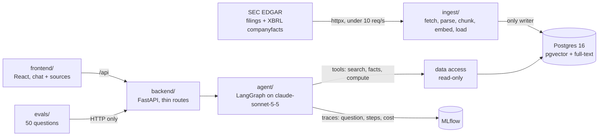

# Plan: the filings pilot

This plan builds the pilot in `docs/SPEC.md`: an offline pipeline that loads 10-K and 10-Q filings and their XBRL facts from SEC EDGAR, the OpenSec Analyst agent that answers questions with a citation for every claim, one backend API that runs it, and a two-pane web UI for the analysts. It follows `docs/TECH_STACK.md`, `docs/CODE_STANDARDS.md`, `docs/PROCESS.md` and `docs/BRAND.md`.

Phase 0 is a lab. It loads AMD's and NVIDIA's filings and confirms that LangGraph can do what the agent needs before any product code depends on it.

## The shape of the build

- **Figures come from XBRL, never from the model.** The agent's fact tool returns XBRL values with their unit, period and source filing. The model refers to a fact by its id; Python formats it as `$1,250.0M in FY2025`. The model never types a number, so it can't invent or round one (R-07, R-08).
- **Math happens in a tool.** Changes, differences, ratios and sums run in a Python `compute` tool over fact ids. The answer cites the computation, and the computation cites its facts.
- **Every claim carries a citation that is checked before it's shown.** A claim cites a passage id with a short quote, an XBRL fact id or a computation id. Before an answer leaves `agent/`, Python checks that each passage id exists and that each quote is an exact substring of that passage. An answer that fails this is not shown (R-03).
- **The agent only sees what its tools return.** It has no file access, and no tool reads `evals/` (R-11).
- **Review comes from the trace.** Each answer is an MLflow trace holding the question, tool calls, sources, tokens and cost. The backend reads the trace back to show an answer later, so the backend never writes the database (R-06).

## Decisions for review

1. **The agent framework is LangGraph.** Phase 0 confirms that it works on our samples and records the decision in `docs/STATUS.md`. It doesn't compare LangGraph with other frameworks. Once Phase 0 passes, I'll change the "Agent framework" row in `docs/TECH_STACK.md` from TBD to LangGraph (`langgraph` with `langchain-anthropic`). If Phase 0 fails, I'll stop and report back.
2. **Phase 0 lives in `labs/` and writes files, not the database.** The lab caches raw filings and companyfacts JSON under `data/filings/`, which git ignores, and keeps its search index in memory. The `ingest/` pipeline in Phase 1 is built properly from tests. It reuses the cache but not the lab's code, and no product code imports from `labs/`.
3. **Companies.** `data/tickers.yaml` starts with AMD (CIK 0000002488) and NVIDIA (CIK 0001045810). The other 18 depend on SPEC open question 1. The pipeline loads whatever is in `tickers.yaml`, so they can be added at any time.
4. **The filing window.** "The last 3 fiscal years" means the 10-Ks for the last three completed fiscal years, the 10-Qs within those years, and the 10-Qs filed so far in the current fiscal year. Periods use each company's own fiscal calendar. NVIDIA's FY2026 ended in January 2026, and the UI labels it "FY2026", not "2025" (R-09).
5. **Lab samples.** I'll draft 10 questions in `data/labs/samples.yaml`: 4 facts, 3 comparisons (one period change and two AMD-versus-NVIDIA peer questions), 2 risk questions and 1 with no answer. Expected figures come from XBRL and expected passages from the filings. Each sample stays `reviewed: false` until an analyst checks it. These samples are separate from the 50 questions in `evals/` and never feed them.
6. **Chunks follow the filing's Items.** Filings are split by Item (Item 1A, Item 7, and so on), then into chunks of a few paragraphs. Each chunk stores its ticker, form, fiscal period, Item, accession number and the character offsets in the source document. That's what produces a chip like `AMD 10-K 2025 · Item 7` and the highlighted passage beside the answer.
7. **Search.** The search tool runs pgvector similarity and Postgres full-text search, then merges the results with reciprocal rank fusion. It filters by ticker, form and fiscal period.
8. **Restated figures.** A fact counts as restated when a later filing reports a different value for the same concept and period. The fact tool returns the latest value, flagged and paired with the earlier value, and the answer's caveats say so (R-09).
9. **Follow-ups.** The context of a follow-up like "and last year?" lives in a LangGraph Postgres checkpointer, keyed by `conversation_id`, in its own `agent_state` schema (R-04). **This breaks the rule that only `ingest/` writes the database, so it needs your approval.** The alternative is an in-memory checkpointer, which loses every conversation when the backend restarts.
10. **The answer format.** The agent returns a structured answer: a `summary` of one or two sentences, then a `table` or `bullets`, then `caveats`. Each item lists its claims with their citations. Python renders the figures and the chips (R-02, R-05). Answers arrive whole rather than streamed. Streaming can be added later if the 15-second median needs it.
11. **Cost.** Cost is computed in Python from the token counts in the trace, at per-token prices set in `.env` (`PRICE_INPUT_PER_MTOK`, `PRICE_OUTPUT_PER_MTOK`). The pilot doesn't hard-code any prices.
12. **Refusals.** Requests for investment advice, stock prices or anything outside the filings get a short, polite refusal from the agent's instructions, with no tool calls (R-10).
13. **Adding filings on demand.** New filings are added with the ingest command, `uv run -m ingest AMD`. It isn't an API operation, because only `ingest/` writes the database (R-12).
14. **Scoring.** `evals/` checks figures (XBRL equality), "Not disclosed" answers and latency in Python. Answer accuracy and whether each citation supports its claim need judgment. **I propose an LLM judge in `evals/`, but that breaks the rule that only `agent/` calls the LLM.** The alternative is that analysts grade those two items from a sheet the script writes. Which do you prefer? The 50 questions and answers also depend on SPEC open question 2. Until they exist, the scoring script is tested on a small fixture set.
15. **Out of scope, per the spec.** 8-K, Form 4 and proxy filings; more than about 20 companies; sign-in; exports; stock prices.

## API

Every operation has an `operation_id`, a one-line docstring and no optional inputs.

| Method and path                   | operation_id | Used by                                                                            |
| --------------------------------- | ------------ | ---------------------------------------------------------------------------------- |
| `GET /api/health`                 | `health`     | frontend, e2e                                                                      |
| `POST /api/ask`                   | `ask`        | frontend, evals; body `{question, conversation_id}`, returns the answer and its passages |
| `GET /api/answers/{answer_id}`    | `get_answer` | frontend review page; question, answer, sources, steps, tokens and cost (R-06)    |

The frontend creates a `conversation_id` (a UUID) for each new chat, so `ask` has no optional inputs. `answer_id` is the MLflow trace id. `AGENTS.md` describes the backend as "the one API (`/ask`)". `get_answer` and `health` belong to that same API.

---

## Phase 0: The LangGraph lab (AMD and NVIDIA)

Confirm that LangGraph can run the agent this pilot needs, using real filings, before anything depends on it. Set up the repo's tooling at the same time, so this phase and every later one commits through the pre-commit hook.

- Repo skeleton: a root `pyproject.toml` (uv, Python 3.12) and `package.json` with the `check`, `dev` and `evals` scripts, ruff, pyright, pytest, a pre-commit hook, `.env.example`, and `docker-compose.yml` with Postgres 16 + pgvector and MLflow.
- `data/tickers.yaml` with AMD and NVIDIA.
- `labs/BRIEF.md`: the question ("Does LangGraph give us tool calling, structured answers, follow-up memory and MLflow tracing for this agent?"), the method, and the pass bar below.
- A lab notebook that fetches both companies' filings and companyfacts for the window in decision 4, at under 10 requests a second with the User-Agent from `.env`, and caches them under `data/filings/`. It splits the filings by Item, embeds the chunks with Voyage AI into an in-memory index, and runs a LangGraph agent with `search_passages`, `get_fact` and `compute` tools against `data/labs/samples.yaml`. Each run is logged to MLflow.
- `data/labs/samples.yaml`: the 10 draft samples in decision 5.

Success criteria:

- [ ] `uv sync && npm install` installs everything and the pre-commit hook. `docker compose up -d` starts Postgres and MLflow, and `curl localhost:5000/health` returns `OK`.
- [ ] `npm run check` passes on the skeleton.
- [ ] The notebook runs top to bottom with `uv run jupyter nbconvert --execute`, and caches 10-Ks, 10-Qs and companyfacts for both companies. Its request log shows no second with more than 9 requests (R-12).
- [ ] All 10 samples get a structured answer: summary, table or bullets, then caveats (R-02).
- [ ] Every figure in every answer equals its XBRL value, with its unit and fiscal period, and NVIDIA's periods carry its own fiscal-year labels (R-05, R-08, R-09).
- [ ] Every claim has a citation, and every quote is an exact substring of its passage (R-03).
- [ ] The no-answer sample returns "Not disclosed in the filings." (R-07).
- [ ] A follow-up ("and the year before?") on the same thread answers for the earlier period without restating the company (R-04).
- [ ] A question asking for a stock price, and one asking whether to buy, are refused politely with no tool calls (R-10).
- [ ] Every run appears in MLflow as a trace with its tool calls and token counts, and the median latency across the 10 samples is under 15 seconds (R-06, R-13).
- [ ] The result and the decision are recorded in `docs/STATUS.md`, and the "Agent framework" row in `docs/TECH_STACK.md` says LangGraph.

## Phase 1: The ingest pipeline

Load filings and XBRL facts into Postgres, tested and repeatable. Everything after this phase reads from here.

- An Alembic schema with tables for companies, filings, sections, chunks (embedding plus a `tsvector` column) and XBRL facts (concept, value, unit, period start and end, fiscal year and period, accession number, restated flag).
- `ingest/` modules: an EDGAR client (rate limiter and User-Agent behind one small interface), a filings fetcher, an Item parser, a chunker, an embedder (Voyage behind its own interface), an XBRL loader with restatement detection (decision 8), and a loader.
- `uv run -m ingest` loads everything in `data/tickers.yaml`, and `uv run -m ingest AMD` loads a single ticker. Both skip filings that are already loaded.

Success criteria:

- [ ] `uv run pytest ingest` passes, with EDGAR and Voyage mocked from recorded fixtures.
- [ ] A test confirms the EDGAR client never sends more than 9 requests in any second and always sends the User-Agent from `.env` (R-12).
- [ ] The Item parser tests split a fixture 10-K and 10-Q into the expected Items, with offsets that map back to the source text.
- [ ] A test with a fixture where a later filing changes a prior-period value marks that fact restated and keeps both values (R-09).
- [ ] `uv run -m ingest` with AMD and NVIDIA loads the same filings as the EDGAR submissions list for the window, and a second run adds nothing.
- [ ] A SQL check shows AMD's FY2025 revenue fact equals the value in its companyfacts JSON (R-08).
- [ ] `npm run check:python` passes with coverage of at least 80%.

## Phase 2: The OpenSec Analyst agent

The agent answers one question end to end, through its tools alone.

- Read-only data access: hybrid search (decision 7), fact lookup and filing listing.
- `agent/` tools: `search_passages`, `get_fact`, `list_filings` and `compute`. Each returns ids the answer can cite.
- The structured answer model (decision 10), a Python renderer for figures and chips, and the citation check (the shape of the build).
- `agent/instructions.md`: how to answer, when to say "Not disclosed in the filings.", how to label periods and flag restatements, and how to refuse.
- A LangGraph graph built on the model in `MODEL_NAME` (default `claude-sonnet-5-5`), with the checkpointer from decision 9 and MLflow tracing.
- `uv run -m agent "What was AMD's revenue in FY2025?"` answers from the command line.

Success criteria:

- [ ] Agent tests with a stub model drive full runs against a test database: a fact answer renders `$X.XM in FY2025` from the XBRL value, and a stub that cites a missing passage or a quote that isn't in the passage gets its answer rejected (R-03, R-05, R-08).
- [ ] Tests confirm `compute` matches Python's own math for change, percent change and ratio, and that an answer can't contain a figure without a fact or computation id (R-07).
- [ ] A test confirms a follow-up on the same `conversation_id` sees the earlier turn (R-04).
- [ ] A test confirms nothing in `agent/` or `backend/` reads files under `evals/` (R-11).
- [ ] A test confirms a restated fact puts a caveat in the answer (R-09).
- [ ] By hand, with a real model: the 10 lab samples score at least as well as they did in Phase 0, and each run shows in MLflow with tokens and cost.
- [ ] `npm run check:python` passes.

## Phase 3: The backend

The one API the frontend and the evals call.

- A FastAPI app with `health`, `ask` and `get_answer`, using Pydantic models that mirror the structured answer. `ask` also returns the full text and highlight offsets of each cited passage.
- Thin routes: `ask` calls the agent, and `get_answer` reads the MLflow trace and computes cost from token counts (decision 11).

Success criteria:

- [ ] `uv run pytest backend` passes, with the agent stubbed.
- [ ] `curl -X POST localhost:8000/api/ask` with a question and a new `conversation_id` returns a summary, a table or bullets, caveats, and passages with highlight offsets (R-02, R-03).
- [ ] A second `ask` on the same `conversation_id` ("and last year?") answers for the prior period (R-04).
- [ ] `curl localhost:8000/api/answers/{answer_id}` returns the question, sources, steps, tokens and cost (R-06).
- [ ] `/openapi.json` shows an `operation_id` and a summary on every operation, and no optional inputs.
- [ ] `npm run check:python` passes.

## Phase 4: The analyst UI

Chat and cited sources, in OpenSec's brand.

- The shadcn preset `b1uGaJrhQ` set up in `frontend/`, with the tokens in `frontend/src/index.css`, Instrument Sans and JetBrains Mono from Google Fonts, and light and dark mode from `prefers-color-scheme`.
- Two panes: chat on the left and the cited passage on the right, with the quote highlighted. Clicking a citation chip opens its passage.
- Number formatting (`$1,250.0M`, `42.3%`, red negatives in parentheses with a sign on every change), "Not disclosed" in `warning`, and peer charts in `chart-1` to `chart-5` order.
- An answer review page at `#/answers/{answer_id}` (R-06), and a typed API client with no `any`.

Success criteria:

- [ ] vitest tests for the chat, the sources pane, citation chips, number formatting and the review page, with `fetch` stubbed. `npm run check:ts` passes with coverage of at least 80%.
- [ ] In the browser with the Playwright MCP server, asking for AMD's FY2025 revenue shows a summary, then a table, then caveats, each claim ending in a chip like `AMD 10-K 2025 · Item 7`. Clicking a chip shows the passage with its quote highlighted (R-02, R-03, R-05).
- [ ] In the browser, "and last year?" answers for FY2024 (R-04), and the review page shows the question, sources, steps and cost (R-06).
- [ ] A screenshot in both light and dark mode matches `docs/BRAND.md`.

## Phase 5: End-to-end tests, evals and the handover

Lock the journeys in with Playwright, load every company, score the agent and bring the docs up to date.

- Playwright starts its own backend and Vite server against a test database seeded from fixtures, with the agent stubbed so no model is called.
- `evals/` scoring script, run by `npm run evals`: it calls `ask` for each question and reports every R-13 target, using the scoring approach chosen in decision 14.
- A full `uv run -m ingest` over `data/tickers.yaml`.
- `docs/STATUS.md` covers what's built, how to run it, how to add filings and how to run the evals.

Success criteria:

- [ ] `npm run e2e` passes, and passes again on a second run.
- [ ] Tests for the scoring script pass against a fixture set of a few questions, covering a figure mismatch, a wrong "Not disclosed" and a slow answer.
- [ ] `uv run -m ingest` loads every company in `data/tickers.yaml` (R-12).
- [ ] `npm run check` passes in full.
- [ ] `npm run evals` runs on the 50 questions with a real model, and I'll report accuracy, citation support, XBRL figure matches, "Not disclosed" accuracy and median latency against R-13. This needs the test set from SPEC open question 2.
- [ ] `docs/STATUS.md` is up to date.
